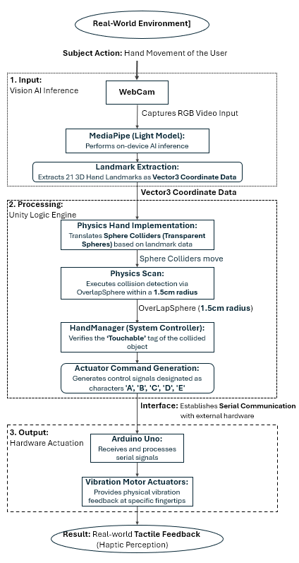
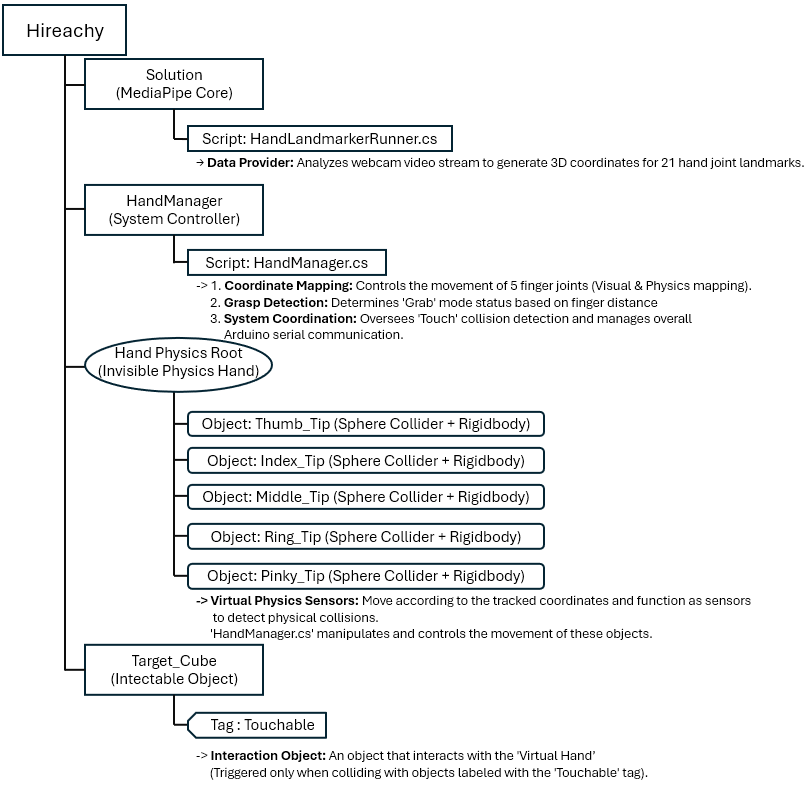
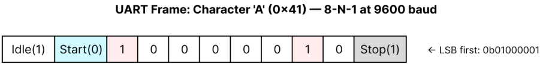
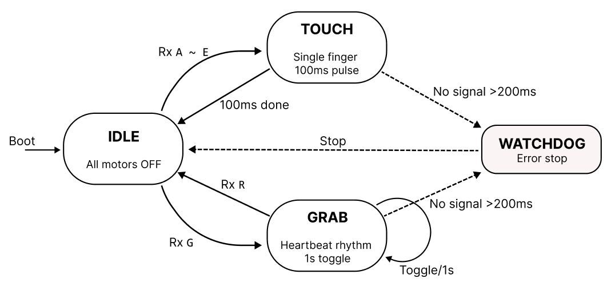

# Low-Cost Haptic Glove for Hand Rehabilitation

A webcam-based haptic glove that gives vibration feedback when a virtual hand touches or grabs an object.
The system combines MediaPipe hand tracking, a Unity physics scene and an Arduino Uno driving five vibration motors.
The total parts cost is 48,400 KRW (about 33 USD).

**Excellence Award, 2025 Adventure Design Competition, Dongguk University**
(Team Son-sational, four members. Sung-hyuk Yoon led the team and wrote the software and firmware pipeline.)

## Motivation

Hand rehabilitation relies on repetitive grasping exercises.
Patients find these exercises hard to sustain because they are monotonous.
Commercial haptic gloves could make the training engaging, but they cost thousands of dollars.
This project tests how much of that experience a webcam, an Arduino and a pair of gloves can deliver.

## System architecture

The pipeline has three stages.
A webcam image goes through MediaPipe Hand Landmarker, which returns 21 landmarks per hand.
Unity moves five invisible fingertip colliders to the landmark positions and checks them against objects tagged `Touchable`.
When a contact or a grab begins, Unity sends a one-byte command over USB serial, and the Arduino drives the matching motor.

## How it works

### Vision to world coordinates

The fingertip landmarks 4, 8, 12, 16 and 20 are mapped into the Unity scene with `Camera.ViewportToWorldPoint`.
The y axis is flipped, since MediaPipe places the origin at the top left and Unity at the bottom left.
Depth is a fixed base distance of 10 units plus the landmark z scaled by a sensitivity factor.
Each fingertip moves toward its target with `Vector3.Lerp` to suppress jitter.

### Touch and grab

A touch is detected with `Physics.OverlapSphere` of radius 0.015 around each fingertip.
A command is sent only when the contact state changes, not on every frame.
A grab starts when the thumb and index fingertips come closer than 0.08 units near a `Touchable` object.
The object is then parented to the index fingertip and follows the hand until the fingers open.

These distances are in Unity units, not in physical centimeters.
The hand is projected about 10 units in front of the camera, so the values were tuned by observation.

### Serial protocol

The link is one-way from Unity to Arduino over USB serial at 9600 baud.
Each command is a single ASCII character, so the firmware needs no parsing.

| Command | Sent when | Firmware response |
|---|---|---|
| `A` to `E` | A fingertip starts touching an object | 100 ms pulse on that finger's motor |
| `G` | Every frame while an object is held | All motors on, heartbeat timer restarted |
| `R` | The object is released | All motors off |
| `a` to `e` | A fingertip stops touching | Ignored |

### Firmware

The firmware runs as a small state machine with IDLE, TOUCH and GRAB states.
A watchdog turns every motor off if no command arrives for 200 ms.
This keeps the motors from staying on when Unity stops or the cable is pulled.

The motors are wired as follows.

| Arduino pin | Motor |
|---|---|
| D2 | Thumb |
| D7 | Index |
| D4 | Middle |
| D5 | Ring |
| D6 | Pinky |

The motors are switched on and off with `digitalWrite`.
D2, D4 and D7 are not PWM pins on the Uno, so the vibration intensity is not adjustable in this build.

### Under the hood of the ATmega328P

`Serial.begin(9600)` sets the baud register UBRR0 to 103, from 16 MHz / (16 × 9600) − 1.
`Serial.read()` does not poll the hardware directly.
A receive interrupt copies each incoming byte into a ring buffer, and `Serial.read()` takes bytes from that buffer.
The watchdog relies on `millis()`, which the Arduino core drives with the Timer0 overflow interrupt.
With a prescaler of 64, this interrupt fires about every 1.024 ms, and the core corrects the accumulated drift.

## Case study. The black glove problem

The first prototype used a black glove.
Hand tracking became unreliable once the glove was worn.

MediaPipe Hands does not detect hands by skin color.
It is a two-stage neural network, a palm detector followed by a landmark model, trained mostly on images of bare hands (Zhang et al., 2020).
A black glove removes most of the shading and texture that outline the fingers.
The input then most likely falls outside what the model saw during training, and the landmarks become unstable.

A thin light-colored nitrile glove restored the visible shape of the hand.
Tracking returned to normal, and the vibration motors could still be mounted on the glove.

## Known issues

A code review in 2026 found the following problems in the final version.

1. **The grab heartbeat never runs.** The firmware is designed to pulse all motors at 1 s intervals during a grab. Unity sends `G` on every frame while an object is held, and each `G` restarts the heartbeat timer. The timer never reaches 1 s, so the motors stay on continuously. This matches the behavior seen in the final demonstration. A fix is to send `G` only when the grab begins, or to restart the timer only on the transition into the GRAB state.
2. **Touch is detected twice.** `HandManager` and `FingerSensor` both detect contact and both send the finger command. One contact can therefore trigger two pulses.
3. **The touch pulse blocks the firmware.** `Vibrate()` uses `delay(100)`, so no command is processed during a pulse. A timer based on `millis()`, as in the heartbeat logic, would remove the block.
4. **Release commands are unused.** Unity sends lowercase `a` to `e` when a contact ends, but the firmware ignores them.
5. **Missing null check.** `CheckTouch()` calls `ArduinoConnector.Instance` without checking that it exists.

## Limitations

The webcam loses the hand when an object blocks the view.
The serial cable limits movement.
The motors only switch on and off, so textures cannot be rendered.
Five motors are too few for detailed tactile sensations.
The system cannot provide resistance when the hand closes, which advanced rehabilitation would need.

## Cost

| Item | Quantity | Cost |
|---|---|---|
| Vibration motor module | 6 | 17,820 KRW |
| Webcam | 1 | 21,890 KRW |
| USB extension cable | 1 | 3,740 KRW |
| Gloves | 1 | 2,200 KRW |
| Velcro tape | 1 | 2,090 KRW |
| Electrical tape | 1 | 660 KRW |
| **Total** | | **48,400 KRW (about 33 USD)** |

The Arduino Uno and the laptop were not part of this budget.

## Files

| File | Content |
|---|---|
| `HandManager.cs` | Coordinate mapping, touch and grab detection, command generation |
| `ArduinoConnector.cs` | Serial port singleton that sends commands to the Arduino |
| `FingerSensor.cs` | Trigger-based touch sensor attached to each fingertip |
| `HandLandmarkerRunner.cs` | Modified sample from MediaPipeUnityPlugin (see Credits) |
| `hap_assist_firmware.ino` | Arduino firmware |

Comments in the Unity scripts are written in Korean.

## How to run

1. Create a Unity 2022.3 project and install [MediaPipeUnityPlugin](https://github.com/homuler/MediaPipeUnityPlugin) v0.16.3.
2. Open the Hand Landmark Detection sample scene and replace its `HandLandmarkerRunner.cs` with the version in this repository.
3. Add `HandManager.cs`, `ArduinoConnector.cs` and `FingerSensor.cs` to the project.
4. Create five small sphere colliders for the fingertips and assign them to `HandManager`.
5. Tag the objects to interact with as `Touchable`.
6. Set Api Compatibility Level to .NET Framework in Player Settings, since `System.IO.Ports` requires it.
7. Upload `hap_assist_firmware.ino` to the Arduino Uno and set the matching COM port in `ArduinoConnector`.

## Credits

`HandLandmarkerRunner.cs` is based on the sample from [MediaPipeUnityPlugin](https://github.com/homuler/MediaPipeUnityPlugin) by homuler, released under the MIT License.
The modified version adds a public field for the detection result, lowers the detection confidence thresholds and skips drawing when no annotation controller is set.
The original copyright notice is kept in the file.

F. Zhang et al., "MediaPipe Hands. On-device Real-time Hand Tracking," CVPR Workshop on Computer Vision for Augmented and Virtual Reality, 2020. arXiv:2006.10214.
